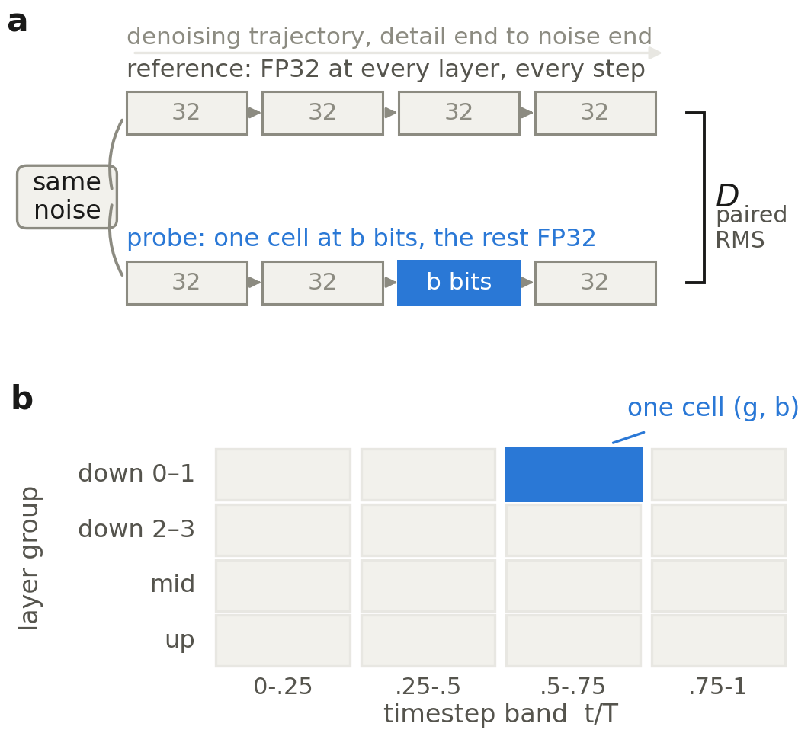
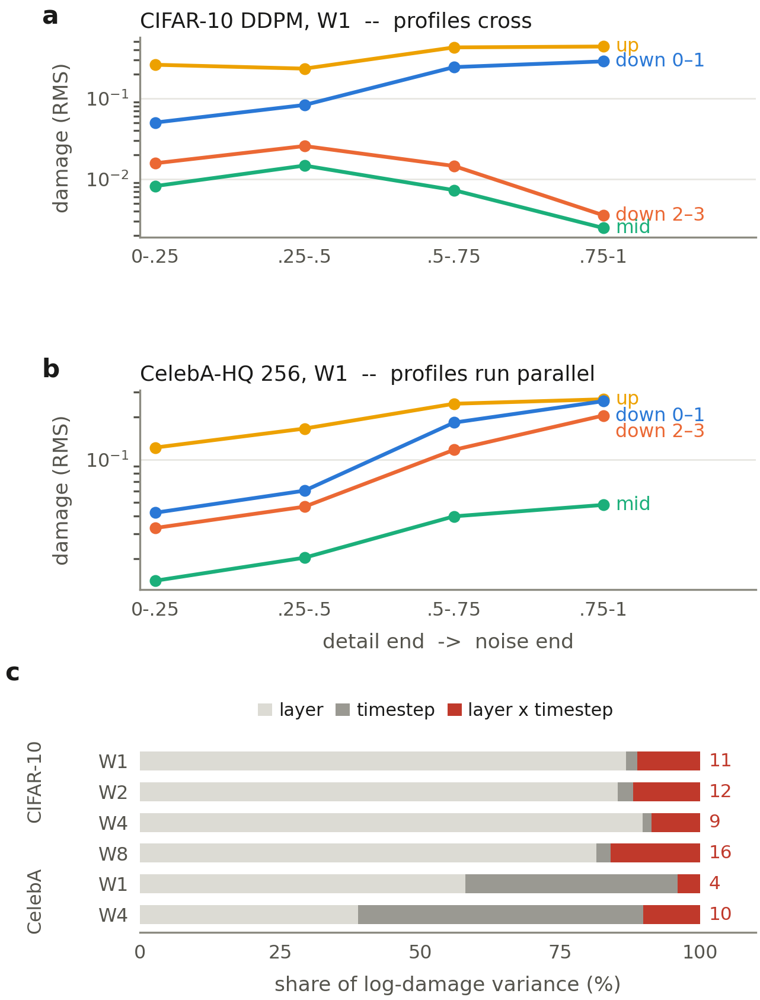
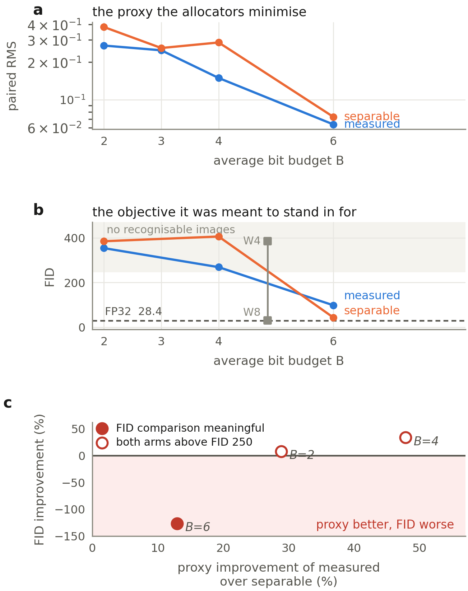

# When Does Layer–Timestep Separability Hold?

Measurement data and code for *When Does Layer–Timestep Separability Hold? Measuring
Sensitivity Structure in Mixed-Precision Diffusion Quantization*.

Munal Singh, Marina Thottakkara, Kashikaa, Deepa D — Vellore Institute of Technology, Vellore, India.

**Accepted at IEEE UPCON 2026**, the 13th IEEE Uttar Pradesh Section International Conference
(IIT Kanpur, 19–21 December 2026).

Mixed-precision quantizers for diffusion models allocate bit-width per layer and per
denoising timestep, and almost all of them summarise sensitivity along one axis with the
other marginalised away. This repository holds the measurements testing whether that
factorisation is adequate. It is not: on a pixel-space CIFAR-10 DDPM the layer-by-timestep
interaction accounts for 8.6–16.0% of log-damage variance against 1.7–2.7% for the timestep
main effect, because the temporal sensitivity gradient reverses sign between network
regions. On a CelebA-HQ 256 denoiser the ordering inverts. Separability is a property of a
particular model, not of diffusion models in general.

<p align="center">
  
  &nbsp;
  
</p>

*Left: the probe. One (layer group, timestep band) cell is quantized at b bits, everything else stays
at FP32, and damage is the paired RMS against the FP32 reference sampled from the same noise. Right:
on the CIFAR-10 DDPM the temporal profiles of different layer groups cross; on CelebA-HQ 256 they run
parallel. Panel (c) splits log-damage variance into layer, timestep and layer × timestep shares.*

The repository also carries a negative result, in full. An allocation derived by minimising
our paired trajectory metric improves that metric by 23.4% on average at matched average
bit-width, yet loses on FID to the separable allocation it was meant to beat at the only
budget producing recognisable images (98.2 against 43.3). Every number behind that claim is
in `data/`.

<p align="center">
  
</p>

*(a) The paired-RMS proxy that allocators minimise: the allocation fitted to measured damage beats
the separable one at every budget. (b) FID, the objective the proxy stands in for: at B = 6, the only
budget with recognisable images, it loses. (c) Proxy improvement against FID change per budget. A
metric can be exactly reproducible and still be the wrong objective.*

## What is measured

Weights are quantized per output channel $`c`$, symmetric and uniform at $`q`$ bits, with the scale
that minimises weight MSE:

```math
Q_q(w)=s_c\,\text{clip}\left(\text{round}\left(w/s_c\right),\ -2^{q-1},\ 2^{q-1}-1\right),\qquad
s_c=\arg\min_{s\gt 0}\left\|W_c-Q_q(W_c;s)\right\|_2^{2}
```

A probe quantizes one cell, layer group $`g_0`$ during the timestep band $`[\tau_0,\tau_1)`$, and leaves
everything else at 32 bits:

```math
q(g,t)=q_0\ \ \text{if}\ \ g=g_0\ \ \text{and}\ \ \tau_0\le t/T\lt\tau_1,\ \ \text{else}\ \ 32
```

Damage is the paired per-pixel RMS between the probed model's images $`\hat x_i`$ and the FP32
reference $`x_i`$ drawn from the same noise ($`N`$ images of $`P`$ pixels), so it carries no sampling
variance:

```math
D(g,k)=\sqrt{\frac{1}{NP}\sum_{i=1}^{N}\left\|x_i-\hat x_i\right\|_2^{2}}
```

Separability is tested by fitting the additive model to log damage and splitting the variance with a
two-way ANOVA. A large interaction share $`\eta^2_{\text{int}}`$ means one-axis allocators throw away
real structure:

```math
\log D[g,k]=\mu+\alpha_g+\gamma_k+\varepsilon_{gk},\qquad
\text{SS}_{\text{tot}}=\text{SS}_{\text{layer}}+\text{SS}_{\text{time}}+\text{SS}_{\text{int}},\qquad
\eta^2_{\text{int}}=\frac{\text{SS}_{\text{int}}}{\text{SS}_{\text{tot}}}
```

Quantizing several cells together is sub-additive, and allocation minimises total damage at an
average bit budget $`B`$:

```math
\hat D_{\text{meas}}\approx c\Big(\sum_{j}D_j\Big)^{\beta},\quad \beta=0.93,\qquad\qquad
\min_{\{q_{gk}\}}\ \sum_{g,k}D[g,q_{gk}]\quad\text{s.t.}\quad\frac{1}{|G||K|}\sum_{g,k}q_{gk}\le B
```

## What is here

    data/       one row per measured observation, no aggregation applied
    scripts/    regenerates every figure and table from data/
    paper/      the manuscript source and its renderer

**Read [`data/README.md`](data/README.md) before plotting anything.** It documents three
caveats that change what the files may legitimately be used for: a known-wrong uniform arm
at budget 6.0 whose correction lives in a second file, two grids that are not matched in
statistical power, and a coarse layer partition that makes the reported interaction share a
lower bound.

## Which file backs which claim

| Claim | Where it appears | File |
|---|---|---|
| Joint sensitivity grid, CIFAR-10 | Fig. 2, Table I | `data/grid_cifar.csv` |
| Joint sensitivity grid, CelebA-HQ | Fig. 3b, Table III | `data/grid_celebahq.csv` |
| Two-way ANOVA split, both models | Tables I and III, Fig. 3c | `data/anova_split.csv` |
| Sign reversal of the temporal gradient | Table II, Fig. 3a | `data/temporal_profiles.csv` |
| Sub-additive composition, Eq. (8) | Section VII | `data/composition_trials.csv` |
| Allocation scored by the paired proxy | Fig. 4a | `data/allocation_paired_rms.csv` |
| FID of every allocation arm | Table IV, Fig. 4b | `data/fid_results.csv` |
| Corrected uniform W8 bracket at budget 6 | Table IV | `data/fid_uniform_w8.jsonl` |
| Cross-device replication | Section IX | `data/cross_hardware.csv` |
| Session-to-session identity | Section IX | `data/session_replication.csv` |

## Reproducing the figures

    python scripts/make_col_figs.py     # figures, at the column measure
    python scripts/make_eqs.py          # display equations
    python paper/build_upcon.py         # renders the manuscript

## Measurement conditions

Damage is the paired per-pixel RMS difference between an image sampled from a probed model
and the full-precision reference drawn from the same fixed noise stream, so the metric
carries no sampling variance. With cuDNN algorithm selection pinned and TF32 disabled, an
identical re-draw of the reference differs by exactly zero, and two independent sessions on
separate machine allocations returned bit-identical results across all 64 CIFAR cells. Grid
results were measured on an NVIDIA T4; a partial replication on an RTX 2050 agrees at
Pearson r = 0.9991 on log damage over 47 overlapping cells. Absolute damage below roughly
1e-4 sits at the cross-device floor and should not be compared between machines.

Both models are sampled with DDIM over 50 steps. Weights are quantized per output channel,
symmetric and uniform, with the scale chosen to minimise weight MSE; activations are not
quantized, and there is no calibration-set reconstruction step, because the object under
study is the sensitivity surface of the unmodified network rather than the best achievable
quantized model. Absolute FID values are therefore not comparable to published
post-training quantization results and are used only to compare arms measured under
identical conditions.
